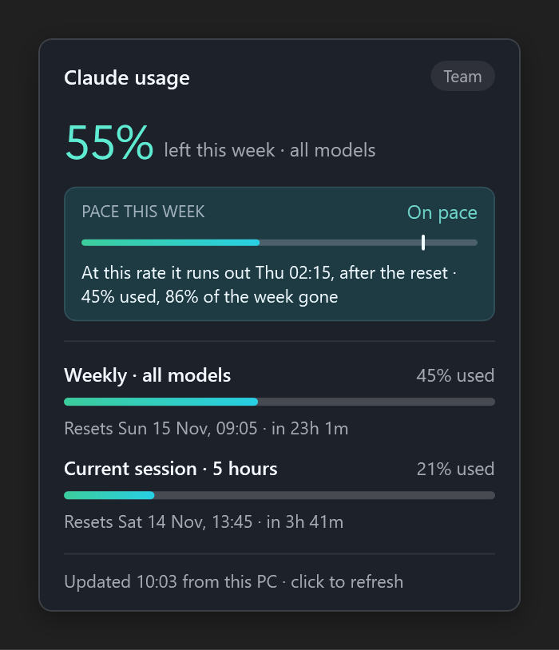
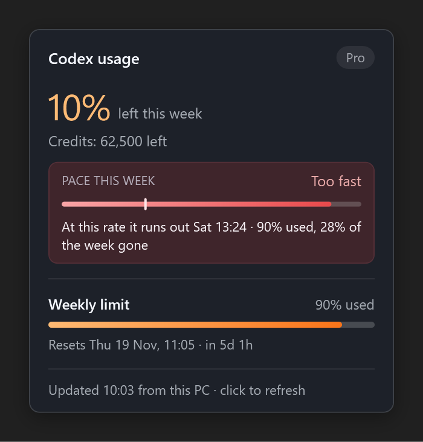
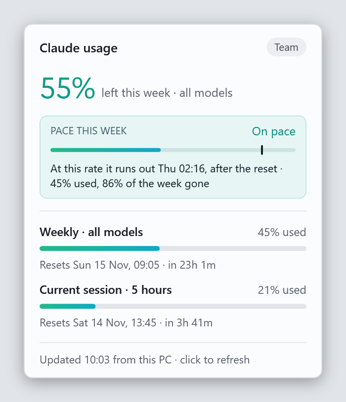
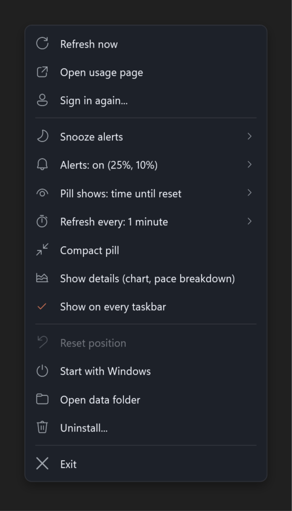

# AI usage taskbar widgets

[](https://github.com/Solarity-AI/ai-usage-taskbar-widgets/actions/workflows/ci.yml)
[](https://github.com/Solarity-AI/ai-usage-taskbar-widgets/releases/latest)
[](https://solarity-ai.github.io/ai-usage-taskbar-widgets/)
[](#requirements)

Two small Windows taskbar widgets show how much of your weekly **Claude** and **Codex** allowance is left. They also show when the allowance runs out at your current pace. Everything runs on your own PC: no server, no telemetry, nothing to sign up for.

**[Website](https://solarity-ai.github.io/ai-usage-taskbar-widgets/)** · **[Download the latest release](https://github.com/Solarity-AI/ai-usage-taskbar-widgets/releases/latest)** · [Changelog](CHANGELOG.md)

<p>
  
  
</p>
<p>
  
  
</p>

## What you get

- **A pill on the taskbar.** A ring shows the share of the weekly allowance left, with the time until the weekly reset (or today's budget). The edge turns orange or red when little is left.
- **A card on hover.** It shows the share left and a *Pace this week* box: *On pace*, *Cutting close* or *Too fast*, with the time the allowance runs out at your current rate. It also has a bar for every limit (weekly, 5-hour session, per-model limits) with its reset time, plus credits or extra usage when your plan has them. Click the pill to pin the card and refresh it.
- **Alerts.** Windows notifications fire at 25% and 10% left, when the limit is reached, and when you are on track to run out before the reset. Thresholds are adjustable, and alerts can be snoozed for 1 hour, until tomorrow morning or until the weekly reset.
- **A right-click menu.** It has *Refresh now*, *Open usage page*, *Sign in again*, *Snooze alerts*, *Alerts*, *Pill shows*, *Refresh every*, *Compact pill*, *Show details* (a burn-up chart of the week and the full pace breakdown), *Show on every taskbar*, *Start with Windows*, *Uninstall* and *About* (version and website).
- **Light and dark themes**, following Windows. Per-monitor DPI. The pills hide while a full-screen app is in front. Drag the main pill sideways to move it; the Codex pill sits next to the Claude pill.

<p>
  
  
</p>

## Requirements

- Windows 10 or 11, with the built-in **Windows PowerShell 5.1**. Nothing to install, no admin rights.
- **Claude widget:** [Claude Code](https://docs.anthropic.com/en/docs/claude-code) signed in on this PC with a Claude subscription (Pro, Max, Team or Enterprise).
- **Codex widget:** the Codex app or CLI signed in on this PC with a ChatGPT plan.

Install one widget or both; they are independent.

## Install

1. Download [**ai-usage-taskbar-widgets.zip**](https://github.com/Solarity-AI/ai-usage-taskbar-widgets/releases/latest/download/ai-usage-taskbar-widgets.zip) from the [latest release](https://github.com/Solarity-AI/ai-usage-taskbar-widgets/releases/latest), or `claude-usage-widget.zip` or `codex-usage-widget.zip` for just one widget. Unzip it anywhere. To check the download, compare `Get-FileHash` with the release's `SHA256SUMS.txt`.
2. In the unzipped folder, double-click **Install Claude widget.cmd** and/or **Install Codex widget.cmd**. If Windows asks whether to run a file from the internet, choose **Run** (or **More info → Run anyway**).

Prefer a terminal? Open the unzipped folder in one: on Windows 11, right-click an empty spot and choose **Open in Terminal**; on Windows 10, hold **Shift**, right-click an empty spot and choose **Open PowerShell window here**. Then run the installer for each widget you want:

```bash
powershell -NoProfile -ExecutionPolicy Bypass -File .\claude-usage-widget\install.ps1
```

```bash
powershell -NoProfile -ExecutionPolicy Bypass -File .\codex-usage-widget\install.ps1
```

Each installer copies the widget to `%LOCALAPPDATA%\ClaudeUsageWidget` (or `CodexUsageWidget`). It adds a Startup shortcut and a Start menu entry, starts the widget, and checks that live data arrives. Running it again updates the widget in place and keeps your settings. `-ExecutionPolicy Bypass` applies to that one command only; it changes no system setting.

## Uninstall

Right-click a pill → **Uninstall…**, or run:

```bash
powershell -NoProfile -ExecutionPolicy Bypass -File .\claude-usage-widget\uninstall.ps1
```

This stops that widget and removes its folder, Startup shortcut and Start menu entry. Add `-KeepData` to keep settings and history. Your Claude or Codex sign-in is never touched.

## How it works and what it reads

Each widget runs a small collector script in a hidden PowerShell process every 1–2 minutes (adjustable).

| | Claude | Codex |
|---|---|---|
| Sign-in it reads | `%USERPROFILE%\.claude\.credentials.json` (or `CLAUDE_CONFIG_DIR`) | `%USERPROFILE%\.codex\auth.json` (or `CODEX_HOME`) |
| Usage it asks for | `api.anthropic.com/api/oauth/usage` | `chatgpt.com/backend-api/wham/usage` |
| Backup source | Claude Code's own `/usage` command (`claude -p "/usage"`), when the service rate-limits, errors or is unreachable | the Codex CLI's `app-server`, when the sign-in is rejected |
| Expired sign-in | Claude Code renews it (`claude -p "/usage"`) | right-click → *Sign in again* (`codex login`) |

- Tokens are read only inside the collector, sent only to the vendor's own usage endpoint, and never logged, cached or passed as command-line arguments.
- The widget never signs in, refreshes or edits your credential files itself; renewal and sign-in go through the official CLIs.
- Rate limits and server errors back off automatically (from 2 minutes up to 30); the last reading is shown, marked as not up to date.
- Local files live in `%LOCALAPPDATA%\<widget>`:
  - `settings.json`
  - `history.json` (15 days of % used and reset times, which drive the pace forecast)
  - `alerts.json`
  - `widget.log`
  - a 60-second usage cache

The usage endpoints are the ones the Claude and Codex apps use themselves. They aren't public APIs and may change; when one does, the widget says so instead of showing wrong numbers.

The pace forecast compares your use with even use over the week. It takes your speed over the last 2–6 hours (or the week's average), works out when the allowance runs out at that speed, and calls it *Too fast* when that is before the reset. It is an estimate from readings on your PC, not an official forecast.

## Troubleshooting

- **Nothing appears after installing.** Run the installer again and read its last lines; it checks the process, the window and the data. `widget.log` in the widget's folder (right-click → *Open data folder*) has the details.
- **"Sign-in needed".** Right-click → *Sign in again*. This opens the official CLI's sign-in; the widget refreshes when that window closes.
- **"Not up to date" for a while.** The usage service is rate limiting. The widget retries by itself; right-click → *Refresh now* forces a try.
- **Antivirus quarantined a script.** Restore it from quarantine, or run the installer again; it reinstalls only what is missing.
- **Installed from an app's built-in terminal (for example the Claude desktop app).** Some app terminals redirect `%LOCALAPPDATA%` into a private sandbox. The installer notices and re-runs itself through a temporary Windows scheduled task, so the widget lands in your real profile and starts with Windows.

## Develop

The two widgets share one codebase. `claude-usage-widget\` is the source. In `codex-usage-widget\`, everything except the collector (`codex-usage.ps1`) and the product block at the top of the widget is generated:

| Command | What it does |
|---|---|
| `powershell -NoProfile -ExecutionPolicy Bypass -File tools\sync.ps1` | Regenerates the Codex widget, installer and uninstaller from the Claude ones; checks that every script parses and has a UTF-8 BOM |
| `powershell -NoProfile -ExecutionPolicy Bypass -File tools\package.ps1` | Builds the release zips and checksums in `dist\`; checks that the version matches `CHANGELOG.md` |
| `powershell -NoProfile -ExecutionPolicy Bypass -File tests\run-tests.ps1` | What CI runs: `sync.ps1 -Check`, the version and packaging check, then both test suites (simulated: fake sign-ins and CLIs, no network) |

Edit the Claude files, run `tools\sync.ps1`, then `tests\run-tests.ps1`. Scripts must stay compatible with Windows PowerShell 5.1 and saved as UTF-8 with BOM.

**Releasing a version:**
1. Raise `$script:Version` in `claude-usage-widget\claude-usage-widget.ps1` and add a section for it at the top of `CHANGELOG.md`.
2. Run `tools\sync.ps1` and `tests\run-tests.ps1`, then merge.
3. Tag the merge commit `v<version>` and push the tag.

The **Release** workflow tests again, builds the three zips and `SHA256SUMS.txt` (`tools\package.ps1`), and publishes the release with that version's changelog section as its notes.

## Copyright

© 2026 Solarity AI. All rights reserved. This repository has no open-source license: its code may not be copied, modified or redistributed.

Not affiliated with Anthropic or OpenAI; Claude and Codex are their respective trademarks.
